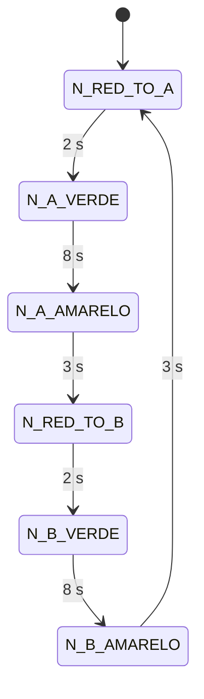

# Fluxo · Controle de tráfego com Arduino Uno

O projeto controla duas vias de um semáforo: a via A usa um módulo com LEDs separados e a via B usa um LED RGB de ânodo comum. Dois botões solicitam prioridade para as vias. O programa alterna os sinais, trata pedidos durante uma emergência, detecta conflito entre os botões e aciona os LEDs de pedestres.

A lógica física está em [`ControleTrafego/ControleTrafego.ino`](ControleTrafego/ControleTrafego.ino), gravado no Uno. O painel permite acompanhar e comandar essa lógica por USB. **Depois de programado e alimentado, o Uno funciona sozinho**, sem Python, navegador ou IDE abertos.

Este README explica primeiro o firmware, depois a comunicação e o uso do painel. Os exemplos de tempo usam os valores padrão.

## 1. Partes do projeto e suas responsabilidades

| Arquivo | Responsabilidade |
| --- | --- |
| [`ControleTrafego/ControleTrafego.ino`](ControleTrafego/ControleTrafego.ino) | Executa no Uno: lê botões, decide estados, conta tempos, aciona saídas, recebe comandos e salva configurações. |
| [`painel/original.ino`](painel/original.ino) | Código original preservado: ciclo e emergência com tempos fixos, sem controle pelo painel. |
| [`app.py`](app.py) | Executa no computador: serve a interface e os arquivos em um endereço local e abre o navegador. |
| [`painel/app.js`](painel/app.js) | Controla a interface, a comunicação Web Serial, as confirmações e a demonstração sem placa. |
| [`painel/apresentacao.js`](painel/apresentacao.js) | Controla o circuito interativo e a apresentação dos exemplos e do código. |
| [`painel/padroes.js`](painel/padroes.js) | Mostra o perfil de referência, restaura/salva os padrões e gera sketches com os tempos escolhidos. |
| [`tests/`](tests/) | Testes do servidor, do navegador, do firmware e da equivalência com o original. |

O Uno é a própria placa Arduino. A distinção de funcionamento é entre **placa sozinha**, **placa com painel conectado** e **simulação sem placa**.

## 2. Entradas, saídas e representação das cores

| Componente | Pinos | Como o código usa |
| --- | --- | --- |
| Semáforo A: verde / amarelo / vermelho | D2 / D4 / D7 | `digitalWrite()` liga o LED correspondente. |
| RGB B: vermelho / verde / azul | D3 / D6 / D5 | `analogWrite()` controla os canais do RGB de ânodo comum. |
| LEDs de pedestres A / B | D9 / D8 | Acendem quando a respectiva via está vermelha. |
| Botões A / B | D11 / D12 | Entradas `INPUT_PULLUP`: solto = `HIGH`; pressionado, ligado ao GND = `LOW`. |

Use resistores limitadores adequados aos LEDs. No RGB de ânodo comum, `0` acende o canal e `255` apaga. O amarelo da via B resulta de vermelho e verde ligados juntos; o azul permanece apagado.

No restante do firmware, as cores são números: **0 = vermelho, 1 = amarelo, 2 = verde**. A função `saidas(a, b)` traduz esses números para os pinos. Por exemplo:

```cpp
saidas(2, 0); // A verde; B vermelha
saidas(0, 1); // A vermelha; B amarela
saidas(0, 0); // ambas vermelhas
```

Antes de aplicar as cores, `saidas()` desliga o verde e o amarelo de A e os canais de B. Depois liga as saídas desejadas, atualiza os pedestres e registra `corA` e `corB`. A escolha de combinações permitidas pertence à máquina de estados: seus caminhos não liberam as duas vias ao mesmo tempo.

Os pedestres acompanham o vermelho de sua via, inclusive quando ambas estão vermelhas. Não existe uma fase exclusiva de travessia nem botão de pedestre. O circuito é uma demonstração em bancada, e a ilustração do painel é funcional, não um esquema elétrico.

## 3. Como o programa começa e se repete

`setup()` executa uma vez após ligar ou reiniciar a placa:

1. Abre a serial a 115200 baud.
2. Configura os pinos dos LEDs como saídas e os botões como `INPUT_PULLUP`.
3. Chama `carregar()` para escolher os tempos: configuração válida da EEPROM ou `PADRAO`.
4. Entra em `N_RED_TO_A`, deixando ambas as vias vermelhas pelo intervalo normal.
5. Envia o evento de inicialização e a configuração pela serial.

`ultimaViaVerde` começa em `2` (B). Isso permite que a primeira via liberada seja A. Com o padrão, a primeira abertura acontece após os 2 segundos iniciais de vermelho.

Em seguida, o Arduino repete este `loop()`:

```cpp
void loop() {
  botoes(); serialReceber(); avancar();
  if(millis()-ultimaTelemetria>=250) { ultimaTelemetria=millis(); status(); }
}
```

A ordem importa: primeiro lê as entradas físicas, depois processa comandos USB, depois verifica o fim da fase. A cada 250 ms, também transmite o estado. A comunicação é consultada mesmo sem painel conectado; não existe espera por conexão para iniciar o ciclo.

### Contagem sem `delay()`

O programa usa `millis()`, o contador de milissegundos desde a inicialização. Cada entrada de estado registra `instanteEstado` e define `duracao`. Em `avancar()`, esta condição impede uma troca antes do tempo:

```cpp
if(estado==PAUSADO || millis()-instanteEstado<duracao) return;
```

Exemplo: se uma fase começou em 10000 ms e dura 8000 ms, em 15000 ms decorreram apenas 5000 ms; o programa mantém a fase. A partir de 18000 ms, pode executar a próxima transição.

A espera não fica em um `delay()`: o `loop()` continua passando pelos botões e pela serial. A subtração com os contadores sem sinal também permite contar o intervalo quando `millis()` retorna a zero após atingir seu limite de 32 bits.

## 4. Máquina de estados: quem decide cores e próxima fase

`enum Estado` dá nome às fases. Duas funções dividem o trabalho:

- **`mudarEstado(novo)`** entra na fase: atualiza `estado`, registra o instante, escolhe as saídas e copia o tempo correspondente para `duracao`.
- **`avancar()`** verifica o tempo e escolhe a próxima fase com um `switch`. Botões e comandos também podem provocar uma mudança antes do fim da fase normal.

### Ciclo normal

| Estado | Via A | Via B | Duração padrão | Próximo estado ao terminar |
| --- | --- | --- | --- | --- |
| `N_A_VERDE` | Verde | Vermelho | 8 s | `N_A_AMARELO` |
| `N_A_AMARELO` | Amarelo | Vermelho | 3 s | `N_RED_TO_B` |
| `N_RED_TO_B` | Vermelho | Vermelho | 2 s | `N_B_VERDE` |
| `N_B_VERDE` | Vermelho | Verde | 8 s | `N_B_AMARELO` |
| `N_B_AMARELO` | Vermelho | Amarelo | 3 s | `N_RED_TO_A` |
| `N_RED_TO_A` | Vermelho | Vermelho | 2 s | `N_A_VERDE` |



O ciclo completo soma **26 segundos**. Os estados `N_RED_TO_A` e `N_RED_TO_B` têm as mesmas saídas, mas guardam destinos diferentes. Assim, o programa sabe qual via abrir depois do intervalo com ambas vermelhas.

### Variáveis que guardam as decisões

| Variável | Significado na lógica |
| --- | --- |
| `estado` | Fase atual; determina qual regra de transição será aplicada. |
| `instanteEstado` / `duracao` | Quando a fase começou e quanto deve durar. |
| `tempos[7]` | Configuração usada ao entrar nas próximas fases. |
| `corA` / `corB` | Cores aplicadas nas saídas; permitem identificar a via que precisa passar pelo amarelo. |
| `viaEmergencia` | Via escolhida para o atendimento prioritário: 1 = A; 2 = B. Não indica sozinha que uma emergência está ativa; isso depende de `estado`. |
| `viaAmarela` | Via que deve ficar amarela durante uma transição de emergência ou parada. |
| `fila` | Um único pedido pendente: 0 = nenhum; 1 = A; 2 = B. |
| `ultimaViaVerde` | Última via liberada, usada para escolher a via oposta na retomada. |
| `conflitoBloqueado` | Impede novos pedidos até que os dois botões tenham sido soltos após um conflito. |
| `pausaSolicitada` | Marca uma parada em andamento ou já concluída e bloqueia prioridades. |

## 5. Botões: leitura, debounce e detecção de uma pressão

O contato de um botão pode oscilar rapidamente ao apertar ou soltar. `botoes()` filtra essa oscilação com **20 ms de estabilidade**, usando três informações por botão:

1. `anterior[i]` guarda a última leitura bruta. Se a leitura muda, o código atualiza `mudanca[i]` com o instante da mudança.
2. Se a leitura permanece por pelo menos 20 ms e difere de `estavel[i]`, ela passa a ser o novo estado estável.
3. `pressionou[i]` fica verdadeiro somente na passagem estável para `LOW`. No início de cada chamada, volta a falso.

Isso separa **estar segurando** de **acabar de apertar**. Segurar um botão não gera pedidos repetidos em cada volta do `loop()`. Um pulso que termina antes da janela de estabilidade não vira uma pressão válida.

Depois da filtragem, `botoes()` verifica o conflito antes de encaminhar pedidos individuais a `solicitar(1)` ou `solicitar(2)`.

## 6. Prioridade: entrada, atendimento e fila

No código, os nomes `E_AMARELO`, `E_VERMELHO` e `E_VERDE` representam as fases de emergência/prioridade. A função `emergencia()` retorna verdadeiro somente nesses três estados.

### Pedido durante o ciclo normal

`solicitar(via)` primeiro recusa pedidos se houver conflito, bloqueio após conflito ou parada. Quando pode atender, guarda a via em `viaEmergencia` e verifica as cores atuais:

- Se alguma via está verde ou amarela, guarda essa via em `viaAmarela` e entra em `E_AMARELO` por 3 s. Mesmo que ela já estivesse amarela, a entrada nesse estado começa uma nova contagem completa.
- Se ambas já estão vermelhas, vai diretamente para `E_VERMELHO` e começa a preparação de 5 s.

Depois, `avancar()` conduz `E_AMARELO → E_VERMELHO → E_VERDE`. Em `E_VERDE`, somente a via solicitada recebe verde, por 10 s, e passa a ser `ultimaViaVerde`.

Exemplo: **B pede prioridade enquanto A está verde**, sem outros pedidos:

| Momento após o pedido aceito | Estado | Saídas |
| --- | --- | --- |
| 0 a 3 s | `E_AMARELO` | A amarela; B vermelha |
| 3 a 8 s | `E_VERMELHO` | Ambas vermelhas |
| 8 a 18 s | `E_VERDE` | A vermelha; B verde |
| 18 a 20 s | `N_RED_TO_A` | Ambas vermelhas |
| A partir de 20 s | `N_A_VERDE` | A verde; B vermelha |

O mesmo procedimento é aplicado se A pedir prioridade enquanto A já está verde: o programa faz a transição de emergência em vez de simplesmente prolongar o verde normal.

### Pedido enquanto uma emergência está em andamento

Se `emergencia()` já é verdadeira, `solicitar()` não reinicia a sequência:

- Pedido da mesma `viaEmergencia`: retorna sem reiniciar o tempo.
- Pedido da outra via: grava essa via em `fila`.

A fila é uma variável de uma posição, não uma lista de eventos. Pedir várias vezes a mesma via pendente mantém um único atendimento agendado. Essa regra vale desde `E_AMARELO`, incluindo a preparação em vermelho e o verde prioritário.

Ao terminar `E_VERDE`, `avancar()` decide:

- **Com fila:** guarda a via atendida em `viaAmarela`, transfere `fila` para `viaEmergencia`, zera a fila e entra em `E_AMARELO`. Seguem 3 s de amarelo da via anterior, 5 s de ambas vermelhas e 10 s de verde da próxima via.
- **Sem fila:** chama `retomar()`. A saída do verde prioritário vai diretamente para o intervalo normal com ambas vermelhas, sem amarelo adicional, preservando o comportamento original.

`retomar()` consulta `ultimaViaVerde`: se A foi a última, escolhe `N_RED_TO_B`; caso contrário, `N_RED_TO_A`. Assim, a volta ao ciclo normal atende a via oposta à última liberada.

## 7. Conflito: os dois botões pressionados

O conflito ocorre quando as duas leituras **estáveis** estão em `LOW` ao mesmo tempo. Não é necessário apertar exatamente no mesmo instante: segurar um botão e depois apertar o outro também pode gerar conflito.

`botoes()` zera `fila`, ativa `conflitoBloqueado` e entra imediatamente em `CONFLITO`, com ambas vermelhas por 5 s. Essa entrada não passa pelo amarelo. Durante o conflito, pedidos de prioridade não são atendidos.

Ao terminar o tempo, `avancar()` chama `retomar()`: cumpre o intervalo normal de 2 s e libera a via oposta à última verde. **O ciclo pode retomar mesmo se os botões continuarem pressionados**, mas novos pedidos seguem bloqueados. O bloqueio só é removido quando ambos são lidos como soltos após o debounce. Isso evita que botões segurados reiniciem o conflito continuamente.

O conflito dos botões físicos e a fila são mecanismos diferentes: dois comandos USB de prioridade recebidos em sequência seguem a regra de atendimento/fila; não simulam os dois contatos físicos pressionados juntos.

## 8. Parada e retomada pelo painel

`STOP` chama `pausar()`: ativa `pausaSolicitada` e cancela a fila. Se alguma via está verde ou amarela, entra em `PARADA_AMARELO` por 3 s e depois em `PAUSADO`. Se ambas já estão vermelhas, entra diretamente em `PAUSADO`.

Em `PAUSADO`, ambas ficam vermelhas por tempo indefinido. Embora `duracao` seja zero, `avancar()` retorna sem mudar de estado. Prioridades pelos botões ou pela USB ficam bloqueadas; uma nova solicitação de parada não reinicia a transição.

`AUTO` só é aceito depois que a placa chega a `PAUSADO`. Ele limpa a solicitação de parada, a indicação de prioridade e a fila, e chama `retomar()`. A próxima abertura respeita o intervalo normal e a alternância pela última via verde. Essa parada é uma extensão do firmware USB; o código original não possui `STOP`/`AUTO`.

## 9. Tempos, RAM e EEPROM

A configuração tem sete posições. `PADRAO`, `MINIMO` e `MAXIMO` definem a referência compilada e os limites, em **milissegundos**:

| Índice em `tempos` | Uso | Padrão | Limites |
| --- | --- | --- | --- |
| 0 | Verde normal A | 8000 ms | 1000–60000 ms |
| 1 | Verde normal B | 8000 ms | 1000–60000 ms |
| 2 | Amarelo normal, de emergência e de parada | 3000 ms | 1000–10000 ms |
| 3 | Intervalo normal com ambas vermelhas | 2000 ms | 1000–10000 ms |
| 4 | Preparação da emergência com ambas vermelhas | 5000 ms | 1000–30000 ms |
| 5 | Verde prioritário | 10000 ms | 1000–60000 ms |
| 6 | Conflito | 5000 ms | 1000–30000 ms |

`SET` valida os sete números em um vetor temporário e só depois copia tudo para `tempos`. Se um valor ou o formato for inválido, a configuração anterior é mantida por inteiro.

`mudarEstado()` copia o tempo da fase para `duracao` na entrada. Por isso, mudar o verde A de 8 s para 12 s enquanto A já está verde mantém os 8 s daquela fase; os 12 s valem na próxima entrada em `N_A_VERDE`.

**RAM** é a configuração em uso, perdida no reinício. **EEPROM** mantém os dados sem alimentação. `salvar()` grava uma estrutura `Memoria` com marca de identificação, versão, perfil-base, sete tempos e checksum. O checksum é um valor calculado a partir dos tempos para conferir sua integridade.

Na inicialização, `carregar()` primeiro copia `PADRAO`. Só substitui pelos valores salvos se a marca for `0x5446`, a versão for `2`, o perfil-base for igual ao `PADRAO` compilado, o checksum conferir e todos os tempos estiverem nos limites. Caso qualquer verificação falhe, continua com o padrão.

Assim, gravar um sketch com outro perfil `PADRAO` não faz o Uno herdar ajustes de um perfil antigo. Regravar o mesmo perfil permite reutilizar a configuração válida salva. A EEPROM guarda **tempos e perfil**, não a fase, a fila ou a condição de parada.

`DEFAULTS` copia o `PADRAO` compilado para a RAM; `SAVE` persiste os valores atuais. No painel, **Restaurar e salvar padrão** aplica os sete valores originais do projeto e os salva. Se o sketch tiver um perfil personalizado, esses valores originais podem diferir do `PADRAO` que o comando serial `DEFAULTS` restaura.

## 10. Comunicação entre o Uno e o painel

O caminho dos comandos é **navegador → Web Serial → USB → firmware**. O Python fornece a página e os arquivos; o firmware continua responsável pela contagem e pelas decisões sobre as saídas.

### Recepção e validação no Arduino

`serialReceber()` lê no máximo 32 caracteres por volta do `loop()`, acumulando uma linha em `entrada[96]`. Ignora `\r` e só chama `comando()` ao receber `\n`. Isso permite receber um comando em várias partes sem executá-lo incompleto.

Se a linha ultrapassar o espaço disponível ou contiver caracteres de controle inválidos, o firmware descarta a linha até o próximo `\n` e responde com falha. O limite de leitura distribui o processamento entre as voltas do `loop()`.

| Comando | Ação no firmware |
| --- | --- |
| `HELLO` | Envia a configuração e o estado para sincronizar o painel. |
| `STATUS` | Envia uma leitura do estado atual. |
| `PRIORITY A` / `PRIORITY B` | Chama `solicitar()` se a fase e os bloqueios permitirem. |
| `STOP` | Solicita a parada controlada. |
| `AUTO` | Retoma somente se já estiver em `PAUSADO`. |
| `SET a b c d e f g` | Valida e aplica sete tempos em ms na ordem da tabela anterior. |
| `SAVE` | Salva a configuração atual na EEPROM. |
| `DEFAULTS` | Restaura na RAM o perfil-base compilado. |

Por exemplo, a linha abaixo aplica os tempos padrão na RAM; a linha `SAVE` os persiste. Cada linha deve terminar com uma quebra de linha:

```text
SET 8000 8000 3000 2000 5000 10000 5000
SAVE
```

### O que a placa devolve

As respostas são linhas JSON: `config` leva os sete tempos; `event` descreve acontecimentos; `ack` confirma ou recusa comandos; `status` leva a telemetria. `HELLO` e `STATUS` retornam seus dados diretamente, sem `ack` separado.

A cada 250 ms, `status()` envia `state`, cores `a`/`b`, `remaining`, `duration`, `queue`, `priority`, `blocked`, `stopping` e `uptime`. `state` corresponde à posição no `enum`: 0–5 são fases normais; 6–8, emergência; 9, conflito; 10, amarelo de parada; 11, pausado. O painel deve interpretar a prioridade junto com a fase, pois `viaEmergencia` pode manter o último valor após o atendimento.

O painel aguarda confirmação dos comandos e bloqueia operações quando perde a sincronização. A confirmação de uma prioridade indica que o pedido foi aceito, não que a via já abriu: ela pode estar em preparação ou na fila.

### O que acontece ao desconectar

Fechar o navegador, encerrar o Python ou perder a serial não envia uma parada automática. Com alimentação mantida, o Uno segue executando a lógica. Se estava pausado, permanece pausado. Se retirar o cabo cortar a alimentação, a placa desliga.

Ao religar, a placa carrega os tempos e começa novamente pelo intervalo `N_RED_TO_A`; não recupera fase, fila ou parada anteriores. Abrir a conexão serial também costuma reiniciar o Uno.

## 11. Código original, firmware USB e simulação

| Modo | Onde a lógica roda | Entradas e recursos |
| --- | --- | --- |
| `painel/original.ino` gravado | No Uno | Botões físicos; tempos fixos; mensagens de texto a 9600 baud. |
| `ControleTrafego/ControleTrafego.ino` gravado, sem painel | No Uno | Botões físicos; tempos compilados ou recuperados da EEPROM. |
| Mesmo firmware com painel USB | No Uno | Botões e comandos; visualização dos estados reais; configuração, persistência e parada. |
| Demonstração sem placa | No JavaScript do navegador | Simulação para explorar a lógica, sem acionar pinos ou gravar EEPROM física. |

No original, as funções `liberarA()`, `amareloA()`, `liberarB()`, `amareloB()` e `ambasVermelhas()` escrevem as saídas. No firmware USB, esse trabalho fica centralizado em `saidas(a, b)`. `iniciarEmergencia()` corresponde a `solicitar()`, `solicitacaoFila` corresponde a `fila`, e `retomarCicloNormal()` corresponde a `retomar()`. As etapas de leitura e tratamento dos botões foram reunidas em `botoes()`.

O firmware USB mantém as transições de ciclo e emergência originais e acrescenta protocolo, tempos configuráveis, EEPROM e parada. O original preservado não recebe os comandos do painel; mudar só a velocidade serial não adiciona esse suporte.

Na apresentação, é possível usar exemplos simulados mesmo com a placa conectada. **Acompanhar Arduino** mostra os estados reais no diagrama; **Simular apresentação** mostra o exemplo didático. Congelar ou avançar a simulação não congela nem avança a placa física.

## 12. Como executar

Para a placa sozinha, abra `ControleTrafego/ControleTrafego.ino` na IDE Arduino, selecione **Arduino Uno**, escolha a porta e carregue. Depois mantenha o Uno alimentado e o circuito montado. Alterações no arquivo `.ino` só passam a valer na placa após novo upload.

Para usar o painel, instale **Python 3.9 ou superior**. Não há pacotes para instalar com pip. Execute:

```sh
python3 app.py
```

No Windows, use `python app.py` ou o atalho `iniciar-painel.bat`. No macOS, também há `iniciar-painel.command`. O iniciador abre o navegador, prefere a porta 8080 e escolhe outra livre se necessário. O serviço atende somente no computador local, em `127.0.0.1`.

Para USB, use **Chrome ou Edge no computador**, feche o Monitor/Plotter Serial e clique em **Conectar Arduino**. A demonstração pode ser usada sem placa. Para iniciar sem abrir navegador ou escolher uma porta livre:

```sh
python3 app.py --no-browser --port 0
```

Use **Encerrar aplicativo** ou `Ctrl+C` para fechar o servidor. Apenas fechar a aba não encerra o Python. A fonte Google Fonts é opcional; o controle não depende de internet.

O painel permite consultar e baixar o original e o firmware USB, exportar o histórico da sessão em CSV e baixar sketches com tempos personalizados. Os downloads não gravam a placa automaticamente. O Python lê o `.ino` diretamente; `source-data.js` e `firmware.ino` são rotas servidas, não cópias para sincronizar. Mudanças na interface pedem recarregar a página; mudanças no Python pedem reiniciar o servidor.

### Porta USB não conecta

Placas compatíveis podem aparecer como **USB Serial**, **CH340** ou **Unknown**. Selecione a porta e escolha **Arduino Uno** na IDE. Confira que o firmware USB deste projeto está gravado; o original não implementa o protocolo do painel.

Feche outras abas conectadas e o Monitor/Plotter Serial. O painel tenta pedir à aba anterior, na mesma origem, que libere a conexão quando identifica uma única placa correspondente e não há operações pendentes. No macOS/Linux, o Python também pode identificar e encerrar apenas o processo separado `serial-monitor` do Arduino que esteja ocupando uma única porta candidata. Essa assistência não encerra a IDE nem o Chrome. Quando não consegue identificar o bloqueio com segurança, orienta a liberação manual.

## 13. Como verificar a lógica

Os testes usam relógio, pinos, EEPROM e serial simulados, permitindo avançar o tempo e conferir as saídas sem depender de uma montagem física.

| Teste | O que verifica |
| --- | --- |
| `tests/firmware_test.cpp` | Ciclo, prioridade/fila, parada, conflito, debounce, validação de comandos, EEPROM e retorno do contador de tempo a zero. |
| `tests/original_equivalence_test.cpp` | Executa original e USB com os mesmos botões e tempos de referência, comparando estados, saídas, fila, bloqueio e instantes das transições. |
| `tests/test_app.py` | Servidor local, entrega dos arquivos, rotas e recuperação do Monitor Serial. |
| `tests/browser_test.mjs` | Interface, apresentação e comunicação com uma porta USB simulada no Chrome. |

Execute os testes Python e de firmware:

```sh
python3 -B -m unittest discover -s tests -p test_app.py -v
clang++ -std=c++17 -Wall -Wextra -Werror -fsanitize=address,undefined -I tests tests/firmware_test.cpp -o /tmp/fluxo-firmware-test
/tmp/fluxo-firmware-test
clang++ -std=c++17 -Wall -Wextra -Werror -fsanitize=address,undefined -I tests tests/original_equivalence_test.cpp -o /tmp/fluxo-original-test
/tmp/fluxo-original-test
```

O teste de equivalência cobre 36 cenários e 259.200 amostras. Para testar o navegador, é necessário Node no ambiente de desenvolvimento:

```sh
node tests/browser_test.mjs
```

`CHROME_PATH` define o executável do Chrome e `PYTHON` escolhe o interpretador. Os arquivos gerados vão para `fluxo-test-artifacts` na pasta temporária; `FLUXO_TEST_ARTIFACTS` permite mudar o destino. Caches, ambientes virtuais, fotos de referência e capturas locais ficam fora do Git pelo `.gitignore`.

O relatório de validação está em [`painel/relatorio-testes.txt`](painel/relatorio-testes.txt), também disponível no painel. Os testes automatizados não fazem upload no Uno nem substituem a conferência da montagem e dos LEDs/botões reais, que permanece pendente no relatório.

## Referências

- [Web Serial — Chrome](https://developer.chrome.com/docs/capabilities/serial/)
- [Arduino Uno R3 — ficha técnica](https://docs.arduino.cc/resources/datasheets/A000066-datasheet.pdf)
- [EEPROM — Arduino](https://docs.arduino.cc/learn/built-in-libraries/eeprom/)
- [Arduino: dispositivos Unknown e conversores CH340](https://support.arduino.cc/hc/en-us/articles/16884223752220-If-there-are-Unknown-devices-in-the-board-selector-or-ports-without-a-board-name-in-the-Tools-Port-menu)
- [Arduino: localizar processos que bloqueiam a porta](https://support.arduino.cc/hc/en-us/articles/4407830972050-Find-and-stop-process-blocking-a-port)
